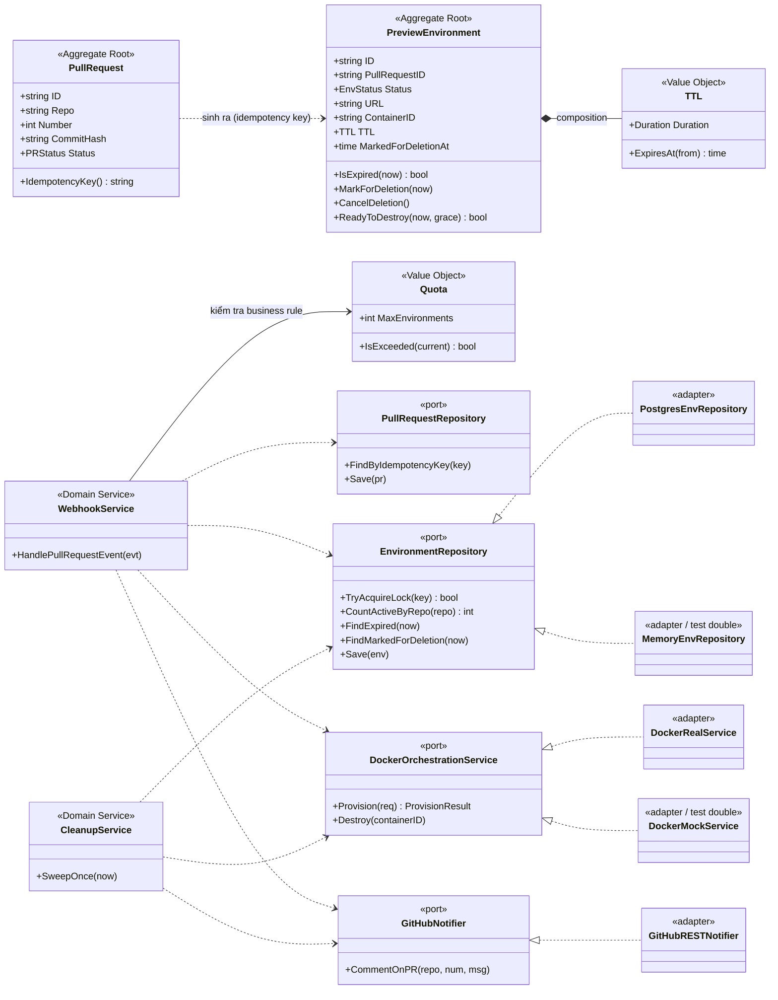
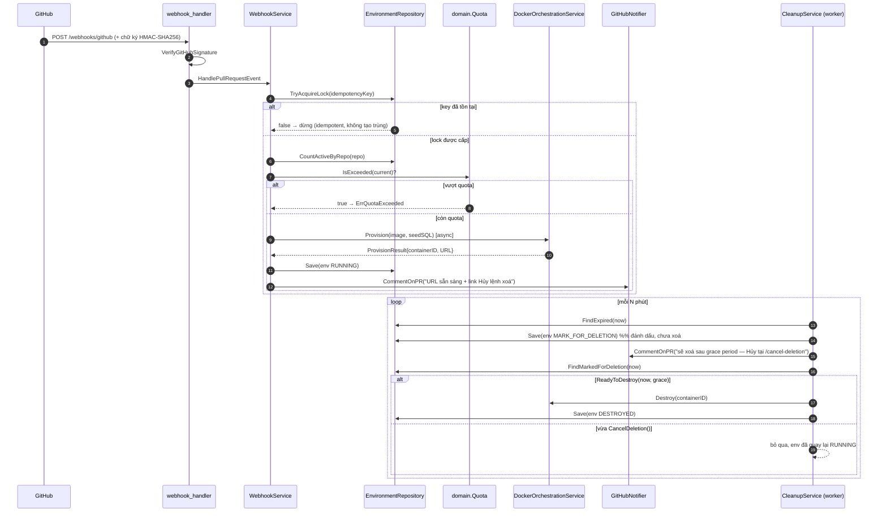

# preview-env-orchestrator

[](https://github.com/psontay/preview-env-orchestrator/actions/workflows/ci.yml)
[](go.mod)
[](LICENSE)

Cổng điều phối môi trường preview theo Pull Request, thiết kế theo
Domain-Driven Design. Nhận webhook GitHub → kiểm tra idempotency & quota →
dựng môi trường (Docker) bất đồng bộ → comment link vào PR → tự động dọn
dẹp theo TTL với cơ chế "destructive safety" (đánh dấu trước, xoá sau).

Toàn bộ code trong repo này **build và chạy được ngay** (`go build ./...`
và `go test ./...` đều pass) bằng các adapter in-memory + Docker giả lập,
để bạn thấy được luồng nghiệp vụ chạy thật trước khi cắm Postgres/Docker
SDK thật vào.

## Kiến trúc (DDD, 3 lớp)

```
cmd/api/main.go              # Composition Root — nơi DUY NHẤT wiring implementation cụ thể
internal/
  domain/                    # Entities, Value Objects, Repository interfaces (KHÔNG phụ thuộc gì bên ngoài)
    pullrequest.go
    environment.go
    valueobjects.go          # Quota, TTL
    repository.go            # PullRequestRepository, EnvironmentRepository (ports)
  application/                # Domain Services điều phối use case, phụ thuộc domain + port
    ports.go                  # DockerOrchestrationService, GitHubNotifier (ports)
    webhook_service.go        # Use case chính: nhận PR event -> idempotency -> quota -> provision
    cleanup_service.go        # Background worker: TTL sweep + destructive safety
  infrastructure/             # Adapter — implement các port ở trên
    memory/                   # In-memory (demo/test): PR repo, Env repo, GitHub notifier giả
    docker/                   # MockService (giả lập docker); xem docs/ để thay bằng Docker SDK thật
  api/handlers/                # HTTP <-> domain translation, KHÔNG chứa business logic
docs/                          # Hướng dẫn tích hợp Docker SDK thật, Postgres, OpenTelemetry
migrations/001_init.sql        # Schema Postgres khớp với domain model
```

**Nguyên tắc phân bổ trách nhiệm (SOLID/DDD):**
- `domain/` không import bất kỳ package nào khác trong repo — nó là lõi bất biến.
- `application/` chỉ phụ thuộc `domain` + các port do chính nó định nghĩa
  (`DockerOrchestrationService`, `GitHubNotifier`) — không biết Docker SDK
  hay Postgres là gì.
- `infrastructure/` implement các port đó — đây là nơi duy nhất "bẩn" với
  chi tiết công nghệ cụ thể.
- Idempotency là trách nhiệm của `EnvironmentRepository.TryAcquireLock`
  (một hành vi lưu trữ), còn Quota là trách nhiệm của `domain.Quota`
  (một business rule thuần) — được `WebhookService` phối hợp gọi theo
  đúng thứ tự, không lẫn logic vào nhau.

### Sơ đồ lớp — Aggregate, Value Object, Service, Port/Adapter



### Luồng nghiệp vụ — từ webhook tới cleanup



## Chạy thử

```bash
go run ./cmd/api
# server lắng nghe tại :8080

curl -X POST http://localhost:8080/webhooks/github \
  -H "Content-Type: application/json" \
  -d '{
    "action": "opened",
    "pull_request": {
      "node_id": "PR_kwDOtest",
      "number": 7,
      "user": {"login": "alice"},
      "head": {"sha": "deadbeef"}
    },
    "repository": {"full_name": "org/app"}
  }'
# -> 202 Accepted, log server sẽ in comment "Môi trường preview đã sẵn sàng..."
```

## Test

```bash
go test ./... -v
```

Bộ test (`internal/application/webhook_service_test.go`) đã verify:
1. Gửi trùng webhook cho cùng 1 commit → chỉ tạo 1 environment (idempotency).
2. Vượt quota → trả về `ErrQuotaExceeded`.
3. TTL sweep → environment hết hạn được đánh dấu `MARK_FOR_DELETION` trước,
   chỉ bị huỷ thật sau khi qua grace period (destructive safety).

## Lên production: còn thiếu gì?

Repo này cố tình dùng adapter in-memory/mock để bạn chạy được ngay không
cần hạ tầng. Trước khi deploy thật, xem 3 tài liệu trong `docs/`:

| Việc cần làm | Tài liệu |
|---|---|
| Thay `MockService` bằng Docker Engine SDK thật (không dùng CLI) | `docs/DOCKER_SDK_INTEGRATION.md` |
| Thay in-memory repo bằng Postgres (dùng schema có sẵn) | `migrations/001_init.sql` |
| Gắn OpenTelemetry trace 3 bước: nhận webhook → ghi DB → gọi Docker | `docs/OPENTELEMETRY.md` |
| Gọi GitHub REST/GraphQL API thật thay vì in ra console | Dùng `google/go-github` hoặc gọi REST trực tiếp trong `GitHubNotifier.CommentOnPR` |

Tất cả các thay đổi trên chỉ cần sửa ở `internal/infrastructure/` và dây
lại ở `cmd/api/main.go` — không cần đụng vào `domain/` hay `application/`.

## Đóng góp

Dự án hoan nghênh đóng góp. Quy trình fork → nhánh → Conventional Commits →
pull request, cùng các lệnh kiểm tra bắt buộc trước khi mở PR, được mô tả
đầy đủ trong [CONTRIBUTING.md](CONTRIBUTING.md).

- Báo lỗi: dùng template **Bug report** trong `.github/ISSUE_TEMPLATE/`.
- Đề xuất tính năng: dùng template **Feature request**.
- Mọi PR cần điền [PULL_REQUEST_TEMPLATE.md](.github/PULL_REQUEST_TEMPLATE.md)
  và giữ nguyên 4 điểm nhấn: Idempotency, Quota, TTL, Destructive-safety.

## License

Phát hành theo giấy phép [MIT](LICENSE).
