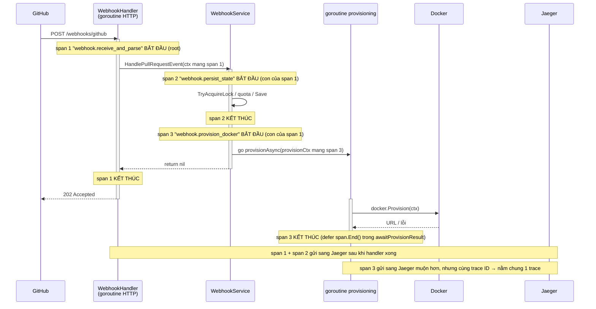

# OpenTelemetry trong dự án này — giải thích cho người mới học

> Tài liệu này KHÔNG dạy lý thuyết OpenTelemetry chung chung. Nó bám sát
> đúng đoạn code vừa được thêm ở **Prompt 5**, để bạn hiểu được chính bài
> của mình trước buổi bảo vệ. Các file liên quan:
>
> - `cmd/api/main.go` — hàm `setupTracing()`
> - `internal/api/handlers/webhook_handler.go` — span thứ 1
> - `internal/application/webhook_service.go` — span thứ 2 và thứ 3
> - `docker-compose.yml` — Jaeger để xem trace

---

## 0. Vấn đề mà OpenTelemetry giải quyết ở đây

Khi GitHub gửi một webhook "có PR mới", hệ thống làm 3 việc nối tiếp:

1. Nhận request HTTP và parse JSON payload.
2. Ghi trạng thái vào DB: khoá idempotency, kiểm tra quota, lưu PR + lưu
   environment.
3. Gọi Docker dựng container preview (chạy **bất đồng bộ** ở goroutine
   riêng, vì có thể mất vài chục giây).

Nếu bước 3 hỏng, log rời rạc rất khó biết "request nào hỏng, hỏng ở khâu
nào, mất bao lâu". **Tracing** cho ta một bức tranh dạng thanh thời gian
(timeline): mỗi bước là một thanh, thanh con nằm bên trong thanh cha, có
mốc bắt đầu / kết thúc / lỗi. Mở Jaeger UI là thấy ngay.

---

## 1. Bốn khái niệm cốt lõi — kèm ví dụ lấy thẳng từ repo

### 1.1. Tracer — "cái máy phát span"

**Định nghĩa ngắn:** Tracer là đối tượng bạn gọi mỗi khi muốn bắt đầu đo
một đoạn công việc. Nó được đặt tên (gọi là *instrumentation scope*) để
sau này biết span do phần code nào sinh ra.

**Trong repo:** cả hai package dùng chung một tên scope
`"preview-env-orchestrator"`:

```go
// internal/api/handlers/webhook_handler.go
var tracer = otel.Tracer("preview-env-orchestrator")

// internal/application/webhook_service.go
var tracer = otel.Tracer("preview-env-orchestrator")
```

`otel.Tracer(...)` lấy tracer từ **provider toàn cục**. Provider đó được
đăng ký một lần duy nhất trong `main.go`:

```go
// cmd/api/main.go, trong setupTracing()
otel.SetTracerProvider(tp)   // dòng ~116
```

Nếu `SetTracerProvider` chưa được gọi (ví dụ trong unit test), `otel.Tracer`
trả về một tracer "rỗng" (no-op): code vẫn chạy bình thường, chỉ là không
có span nào được ghi. Đó là lý do `go test ./...` không cần Jaeger vẫn pass.

### 1.2. Span — "một thanh trên timeline"

**Định nghĩa ngắn:** Span đại diện cho *một* đoạn công việc có mốc bắt đầu
và mốc kết thúc. Span có thể mang thêm:

- **attributes** — cặp key/value mô tả (vd `pr.number = 12`),
- **events** — dấu mốc tức thời trong lòng span (vd "bỏ qua duplicate"),
- **status** — `OK` hoặc `Error`.

Span được tạo bằng `tracer.Start(ctx, "tên")` và **bắt buộc** phải kết
thúc bằng `span.End()`.

**Ví dụ span thứ 2 trong repo** (`webhook_service.go`, dòng ~87):

```go
ctx, dbSpan := tracer.Start(ctx, "webhook.persist_state")
dbSpan.SetAttributes(attribute.String("idempotency.key", key))
// ... TryAcquireLock / CountActiveByRepo / prRepo.Save / envRepo.Save ...
dbSpan.End()   // dòng ~141
```

Đối chiếu từng dòng nghiệp vụ ↔ span:

| Dòng code trong span `webhook.persist_state` | Ý nghĩa |
|---|---|
| `s.envRepo.TryAcquireLock(ctx, key)` | khoá idempotency |
| `s.envRepo.FindByIdempotencyKey(ctx, key)` | chặn webhook lặp |
| `s.envRepo.CountActiveByRepo(ctx, pr.Repo)` + `s.quota.IsExceeded(...)` | kiểm tra quota |
| `s.prRepo.Save(ctx, pr)` / `s.envRepo.Save(ctx, env)` | lưu trạng thái |

Khi một nhánh bị chặn sớm, code không đánh dấu lỗi mà ghi **event** rồi
đóng span (dòng ~97 và ~109):

```go
dbSpan.AddEvent("idempotency: environment đã tồn tại, bỏ qua duplicate webhook")
dbSpan.End()
```

Khi thật sự lỗi (DB chết, hoặc quota vượt) thì gọi helper `endSpanErr`
(dòng ~24) — nó `RecordError` + `SetStatus(codes.Error, ...)` + `End()`:

```go
func endSpanErr(span trace.Span, err error) {
	span.RecordError(err)
	span.SetStatus(codes.Error, err.Error())
	span.End()
}
```

### 1.3. Exporter — "đường ống đẩy span ra ngoài"

**Định nghĩa ngắn:** Exporter quyết định span đã kết thúc sẽ được gửi đi
đâu và theo giao thức nào. Ở đây ta dùng **OTLP** (OpenTelemetry
Protocol) qua **gRPC**.

**Trong repo** (`main.go`, `setupTracing()`, dòng ~97):

```go
exporter, err := otlptracegrpc.New(ctx,
	otlptracegrpc.WithEndpoint(endpoint),   // mặc định "localhost:4317"
	otlptracegrpc.WithInsecure(),           // dev: không TLS
)
```

`endpoint` đọc từ biến môi trường `OTEL_EXPORTER_OTLP_ENDPOINT`. Cổng
`4317` là cổng chuẩn của OTLP/gRPC.

Exporter được gắn vào provider qua `WithBatcher` (dòng ~108):

```go
tp := sdktrace.NewTracerProvider(
	sdktrace.WithBatcher(exporter),   // gom span thành lô, gửi ở nền
	sdktrace.WithResource(...),
)
```

`WithBatcher` nghĩa là: span xong không gửi ngay từng cái, mà xếp vào
hàng đợi, cứ một khoảng thời gian / đủ số lượng thì gửi cả lô. Nhờ vậy
việc xử lý webhook không bị chậm đi vì phải chờ network. Đổi lại, lúc
tắt chương trình phải gọi `tp.Shutdown(ctx)` để "xả" nốt hàng đợi —
trong repo đó là callback trả về từ `setupTracing` và được `defer` ở
`main` (dòng ~40).

### 1.4. Collector — "trạm trung chuyển nhận span"

**Định nghĩa ngắn:** Collector là tiến trình *độc lập với app* đứng ra
nhận span từ exporter, rồi lưu / hiển thị / chuyển tiếp. App không cần
biết backend cuối là gì.

**Trong repo:** ta không chạy OpenTelemetry Collector riêng mà dùng luôn
**Jaeger all-in-one**, vì Jaeger có sẵn cổng nhận OTLP. Xem
`docker-compose.yml`:

```yaml
services:
  jaeger:
    image: jaegertracing/all-in-one:1.60
    environment:
      COLLECTOR_OTLP_ENABLED: "true"     # bật cổng nhận OTLP
    ports:
      - "16686:16686"   # UI xem trace
      - "4317:4317"     # OTLP/gRPC — đúng cổng exporter trỏ tới
```

Luồng đầy đủ:

```
app (exporter OTLP/gRPC)  ──4317──►  Jaeger (nhận + lưu)  ──►  Jaeger UI :16686
```

Lên production chỉ cần đổi `OTEL_EXPORTER_OTLP_ENDPOINT` trỏ tới một
OpenTelemetry Collector nội bộ; Collector đó export tiếp sang Jaeger /
Tempo / Datadog... mà **không phải sửa dòng code Go nào**.

---

## 2. Ba span đã tạo — quan hệ cha/con và goroutine

### 2.1. Danh sách span

| # | Tên span | Tạo ở đâu | Kết thúc ở đâu | Chạy trong |
|---|---|---|---|---|
| 1 | `webhook.receive_and_parse` | `webhook_handler.go:56` | `defer` khi `ServeHTTP` return (`:57`) | goroutine của HTTP handler |
| 2 | `webhook.persist_state` | `webhook_service.go:87` | `dbSpan.End()` — `:141` (hoặc nhánh sớm) | vẫn goroutine HTTP handler |
| 3 | `webhook.provision_docker` | `webhook_service.go:152` | `defer span.End()` trong `awaitProvisionResult` (`:187`) | **goroutine riêng** |

### 2.2. Ai là con của ai

- Span 1 là **root span** — không có cha, mở từ `r.Context()`.
- Span 2 là **con của span 1**: handler truyền `ctx` (đã mang span 1)
  xuống `HandlePullRequestEvent`, và span 2 mở từ chính `ctx` đó.
- Span 3 **cũng là con của span 1**, KHÔNG phải con của span 2. Lý do:
  trong code ta giữ lại `parentCtx` *trước khi* mở span 2:

  ```go
  parentCtx := ctx                                  // còn mang span 1
  ctx, dbSpan := tracer.Start(ctx, "webhook.persist_state")   // span 2
  ...
  dbSpan.End()
  provisionCtx := context.WithoutCancel(parentCtx)  // quay lại span 1
  provisionCtx, dockerSpan := tracer.Start(provisionCtx, "webhook.provision_docker") // span 3
  ```

  Về mặt nghiệp vụ "ghi DB" và "provisioning" là hai bước **nối tiếp
  nhau**, không lồng nhau, nên để chúng làm **anh em** (cùng cha) phản
  ánh đúng thực tế hơn.

### 2.3. Sơ đồ



Điểm mấu chốt: span 1 và span 2 kết thúc **trước** khi client nhận 202;
span 3 kết thúc **sau đó rất lâu**. Nhưng vì cả ba mang **cùng một trace
ID**, Jaeger ghép chúng lại thành một trace duy nhất — bạn thấy thanh
`provision_docker` kéo dài vượt ra ngoài thanh `receive_and_parse`.

---

## 3. Vì sao phải truyền context mang trace ID vào goroutine provisioning

### 3.1. "trace ID nằm trong context"

Khi gọi `tracer.Start(ctx, ...)`, hàm trả về một `ctx` **mới** bên trong
có chứa "span hiện hành" (và kèm theo là trace ID + span ID). Bất kỳ
`tracer.Start` nào sau đó nhận `ctx` này sẽ tự động lấy span trong đó làm
**cha**. Nói cách khác: **quan hệ cha/con được truyền đi qua `context.Context`,
không phải qua biến toàn cục.**

### 3.2. Chỗ dễ sai: goroutine bất đồng bộ

`provision` chạy trong goroutine riêng để không chặn HTTP handler. Goroutine
sống lâu hơn request. Vấn đề: `r.Context()` của một request HTTP **bị huỷ
(cancel)** ngay khi handler return. Nếu ta truyền thẳng `ctx` đó vào
goroutine, thì `docker.Provision(ctx, ...)` có thể bị ngắt giữa chừng vì
"context đã cancel".

Giải pháp trong repo (`webhook_service.go:151`):

```go
provisionCtx := context.WithoutCancel(parentCtx)
```

`context.WithoutCancel` tạo một context **giữ nguyên mọi value** (trong đó
có span/trace ID) **nhưng bỏ tín hiệu huỷ**. Nhờ vậy:

- span 3 vẫn nối đúng vào trace gốc (vì value còn đó),
- provisioning không bị chết theo request HTTP.

### 3.3. Nếu lỡ dùng `context.Background()` thì sao?

Giả sử ai đó "dọn code" và sửa dòng 151 thành:

```go
provisionCtx := context.Background()   // ❌ SAI
provisionCtx, dockerSpan := tracer.Start(provisionCtx, "webhook.provision_docker")
```

`context.Background()` là context **trắng** — không có span nào bên trong.
Khi đó `tracer.Start` không tìm thấy cha, nên nó tạo ra một **trace ID
hoàn toàn mới**. Hậu quả trên Jaeger:

- Bạn tìm trace của webhook → chỉ thấy span 1 + span 2, cụt ở đó.
- Span `provision_docker` biến thành **một trace riêng lẻ**, mồ côi,
  không biết thuộc PR nào, không nối được với webhook đã sinh ra nó.
- Đúng lúc cần nhất — khi provisioning lỗi — thì lại **mất dấu vết**
  liên kết. Trace bị "đứt".

Đây chính là lỗi mà `git log` của Prompt 5 và file `docs/OPENTELEMETRY.md`
cảnh báo. Trong code cũ (trước Prompt 5), cả `provisionAsync` lẫn
`awaitProvisionResult` đều tự tạo `context.Background()` — Prompt 5 đã thay
bằng `provisionCtx` truyền xuyên suốt.

---

## 4. Câu hỏi vấn đáp có thể gặp (ôn trước khi bảo vệ)

**Hỏi 1: Span là gì? Khác log ở chỗ nào?**
Span là bản ghi *một đoạn công việc có thời lượng* (có mốc bắt đầu, mốc
kết thúc, và quan hệ cha/con với span khác). Log chỉ là dòng chữ tại một
thời điểm, rời rạc, không tự biết dòng này với dòng kia thuộc cùng request.
Trace = cây các span cùng một trace ID, cho thấy toàn bộ hành trình một
request và thời gian từng khâu.

**Hỏi 2: Trong đồ án em tạo mấy span, tên gì, span nào là cha?**
Ba span: `webhook.receive_and_parse` (root, ở handler),
`webhook.persist_state` (con của root, bọc khâu ghi DB),
`webhook.provision_docker` (cũng con của root, chạy trong goroutine riêng
và kết thúc muộn hơn). Span 2 và span 3 là anh em vì hai khâu nối tiếp
nhau chứ không lồng nhau.

**Hỏi 3: Vì sao span provisioning phải kết thúc trong goroutine chứ
không phải khi handler return?**
Vì công việc thật (gọi Docker) chỉ xong ở goroutine đó. Nếu `End()` span
ngay khi handler return, thời lượng span sẽ sai bét — nó báo "0,5 giây"
trong khi thực tế dựng container mất 30 giây. Nên `awaitProvisionResult`
mới `defer span.End()`.

**Hỏi 4: `context.WithoutCancel` để làm gì? Không có nó thì sao?**
Nó cho goroutine provisioning thừa hưởng trace ID từ request nhưng không
bị huỷ theo request. Không có nó mà truyền thẳng `r.Context()` thì
provisioning bị cancel ngay khi client nhận 202; còn nếu thay bằng
`context.Background()` thì mất trace ID → span provisioning tách thành
trace mồ côi.

**Hỏi 5: Exporter với Collector khác nhau ra sao? Đổi backend có phải
sửa code không?**
Exporter nằm *trong* app, chịu trách nhiệm đóng gói span và gửi đi theo
giao thức OTLP. Collector (ở đây là Jaeger) là tiến trình *ngoài* app,
nhận span rồi lưu/hiển thị. Đổi backend (Jaeger → Tempo/Datadog) chỉ cần
đổi biến môi trường `OTEL_EXPORTER_OTLP_ENDPOINT` trỏ tới Collector khác,
không sửa code Go.

**Hỏi 6 (dự phòng): Chạy `go test` có cần Jaeger không? Vì sao?**
Không. Test không gọi `setupTracing()` nên không có TracerProvider toàn
cục; `otel.Tracer(...)` trả về tracer no-op, mọi `tracer.Start` / `End`
thành lệnh rỗng. Logic nghiệp vụ không đổi, test vẫn pass.

---

## 5. Cách tự xem trace (demo lúc bảo vệ)

```bash
# 1. Bật Jaeger
docker compose up -d jaeger

# 2. Chạy app (mock adapter, không cần Postgres/Docker thật)
go run ./cmd/api

# 3. Bắn thử một webhook
curl -X POST http://localhost:8080/webhooks/github \
  -H "Content-Type: application/json" \
  -d '{"action":"opened","pull_request":{"node_id":"PR_1","number":1,"user":{"login":"alice"},"head":{"sha":"abc123"}},"repository":{"full_name":"org/app"}}'

# 4. Mở http://localhost:16686 , chọn service "preview-env-orchestrator",
#    bấm "Find Traces" → mở trace vừa tạo → thấy 3 thanh span lồng nhau.
```
